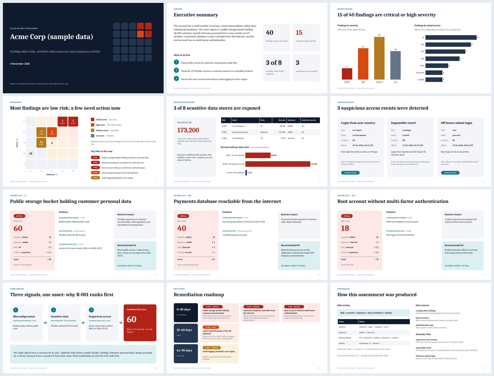

# secassess-mcp

**An AI security assessment agent.** Claude, ChatGPT or Codex connects to cloud
security data through an MCP server, investigates it with tools, answers
questions with cited evidence, and generates an editable PowerPoint and PDF
assessment report.

> Ask *"What are our biggest data risks?"* and the agent finds that a public
> storage bucket holding 48,200 customer records was accessed from a new
> country, explains why that ranks first, and builds the deck.



**Sample output:** [sample_report.pptx](examples/sample_report.pptx) · [sample_report.pdf](examples/sample_report.pdf)
(All data is synthetic.)

## How it works

```
Claude / ChatGPT / Codex
        │  natural-language question
        ▼
   MCP server  ── tools: get_organization_summary, top_risks, list_findings, get_asset,
        │                get_data_inventory, query_auth_logs, detect_anomalies, generate_report
        ▼
   REST API (FastAPI)  ── stands in for the security platform's API
        │
        ▼
   Security data: configuration findings (CSPM) · data inventory (DSPM) · sign-in logs (SIEM)
```

1. **Correlate.** Findings, sensitive data and sign-in activity are joined on `asset_id`.
2. **Score.** `risk = severity × exposure × data sensitivity × activity`, with the
   breakdown and evidence kept for every risk, so the agent can always explain a rank.
3. **Investigate.** The agent chains tools to answer the question and cites evidence IDs.
4. **Report.** The deck is built from the data; the AI writes only the narrative.

## Accuracy by design

Consulting-grade reports fail when a figure is wrong. This project treats that as an
engineering problem, not a prompting problem:

- **Numbers never pass through the model.** Every chart, table and figure in the deck
  is drawn from the backend's JSON. The AI supplies only three pieces of prose.
- **The narrative is checked.** If the AI's text contains any number not found in the
  data, the report builder rejects it with the offending number, and the agent retries.
- **The data is checked.** Before building, a contract check confirms totals add up,
  every score equals its factor breakdown, and every factor matches the scoring model.
- **Tests read the finished deck back.** They open the `.pptx` and confirm every number
  on every slide traces to the data, chart values match exactly, and two runs produce
  identical output.
- **Charts stay native.** They're real PowerPoint charts, so the client can edit them.

## The report (12 slides)

Title · Executive summary · Posture scorecard · Risk heatmap · Sensitive data exposure ·
Suspicious activity · Top 3 risks (score breakdown, evidence, business impact, fix) ·
Correlated risk story · 30/60/90-day remediation roadmap · Methodology

## AI platforms

| Platform | How it connects | Files |
|---|---|---|
| Claude (Desktop / Code) | Local MCP server over stdio | `skills/claude/SKILL.md` |
| OpenAI Codex | Same MCP server, via `~/.codex/config.toml` | `skills/codex/AGENTS.md` |
| ChatGPT custom GPT | REST API actions (remote deployment) | `skills/gpt/instructions.md`, `skills/gpt/openapi.yaml` |

All three follow the same investigation workflow and evidence rules.

## Quick start

```bash
pip install -e ".[dev]"
pytest -q

# Build the sample report from the example data
python -m reporting contracts/report_data.example.json \
    --narrative contracts/narrative.example.json --out output --fmt pptx
# --fmt pdf needs LibreOffice (set SOFFICE_CMD if it isn't on PATH)
```

## Project layout

```
contracts/     data contract between backend and reporting (+ HANDOFF.md)
reporting/     deck builder, native charts, theme, PDF export, contract and number checks
skills/        Claude Skill, GPT instructions + OpenAPI schema, Codex AGENTS.md
tests/         contract checks and slide-by-slide number tests
examples/      generated sample deck and PDF
data/ api/ mcp_server/ analysis/   sample data, REST API, MCP server, scoring (in progress)
```

## Tech

Python · Model Context Protocol · FastAPI · pandas · python-pptx · LibreOffice · pytest
